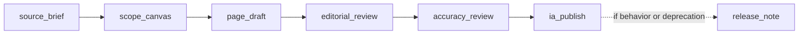
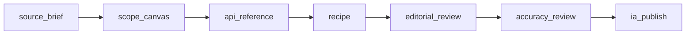
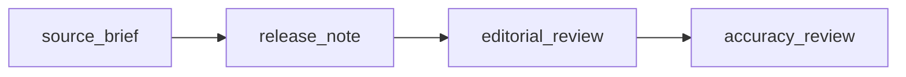
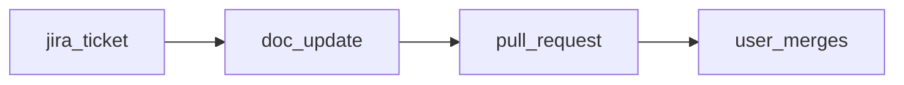
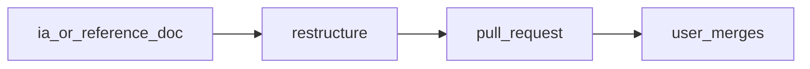

# Writer OS — Collaboration map

Motions for PayU developer docs. A skill does not start the next skill in the same turn unless the user asked for a chain, and even then each handoff waits for confirmation.

These files are not published. Do not add this folder to the docs navigation.

## Skill → next role

| From skill | Output | To role | Next action |
|------------|--------|---------|-------------|
| `writer-source-brief` | Source brief | Content lead | `writer-scope-canvas` |
| `writer-scope-canvas` | Scope canvas | Technical writer | `writer-page-draft` and/or `writer-api-reference` |
| `writer-page-draft` | Page + annexure | Editor | `writer-editorial-review` |
| `writer-api-reference` | API page + annexure | Technical writer or Editor | `writer-recipe` if the page promises code; otherwise `writer-editorial-review` |
| `writer-recipe` | Recipe files + annexure | Editor | `writer-editorial-review` |
| `writer-editorial-review` | Editorial review | Editor | `writer-accuracy-review` |
| `writer-accuracy-review` | Accuracy review | Publisher | `writer-ia-publish` |
| `writer-ia-publish` | IA change list | Publisher or Content lead | `writer-release-note` only if reader-visible behavior or deprecation changed; otherwise stop |
| `writer-release-note` | Release or deprecation note + annexure | Editor | `writer-editorial-review` if not already done for that note |
| `writer-doc-update` | Branch, commit, pull request into `v1` | User (Publisher) | Merge the PR, or send it back. No further skill |
| `writer-restructure` | New or moved pages, `_order.yaml`, pull request into `v1` | User (Publisher) | Merge the PR, or name the page that misses the outline |

## Motion A — New or revised guide

## Motion B — API reference

`writer-recipe` reads the confirmed API page. It does not invent fields the page or the OpenAPI file does not list. Accuracy review covers the page and the recipes together.

Skip `writer-recipe` only when the confirmed scope canvas says the page has no code samples.

## Motion C — Deprecation or what's-new only

Use when no guide or API page is being rewritten. If more than one page or any public contract sentence changes, run Motion A from `writer-scope-canvas` instead.

## Motion D — Existing doc update

The JIRA ticket is the scope. Do not run source brief or scope canvas first. One skill opens the pull request and stops. The user merges. Branch name: `v1_<ISSUE-KEY>-<short-slug>`.

Ticket shape: [ticket-format.md](ticket-format.md).

## Motion E — Restructure

The user supplies an information architecture or a reference doc. The agent does not invent the tree. One skill creates the files, updates `_order.yaml` for those files, opens the pull request, and stops. The user merges. Branch name: `v1_restructure-<slug>`, or `v1_<ISSUE-KEY>-<slug>` when a key is supplied.

## Cold start

The user may start at a later skill only by saying the stage starts cold and stating audience, non-goals, and source paths in the same message. Record that waiver at the top of the artefact.

## Roles

- **Content lead** — scope canvas, final publish confirmation
- **Technical writer** — source brief, page draft, API reference, recipe
- **Editor** — editorial review, accuracy review
- **Publisher** — IA publish, release note, and the merge of a doc-update or restructure pull request
- **User** — on Motion D and Motion E, the user is the Publisher who merges
