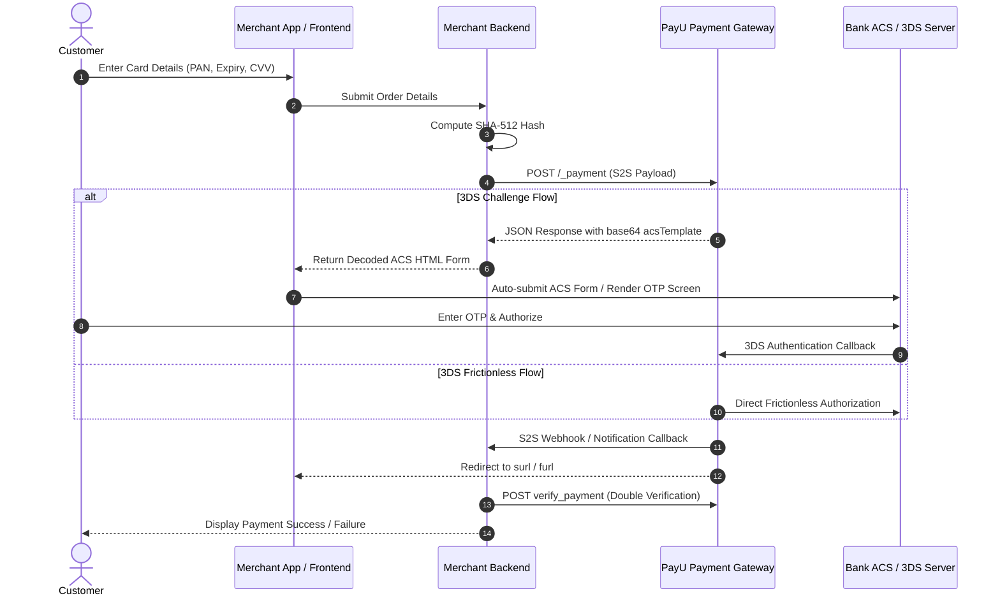
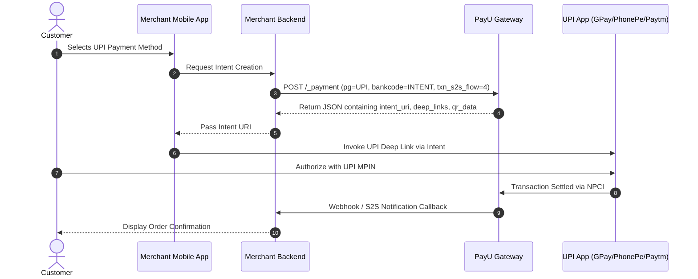

PayU Server-to-Server architectures communicate through direct backend REST API calls, returning cryptographic tokens, ACS challenge payloads, or deep-link URIs depending on the selected payment method.

***

## 1. Cards S2S Flow (Classic & Decoupled)

***

## 2. UPI Intent S2S Flow

