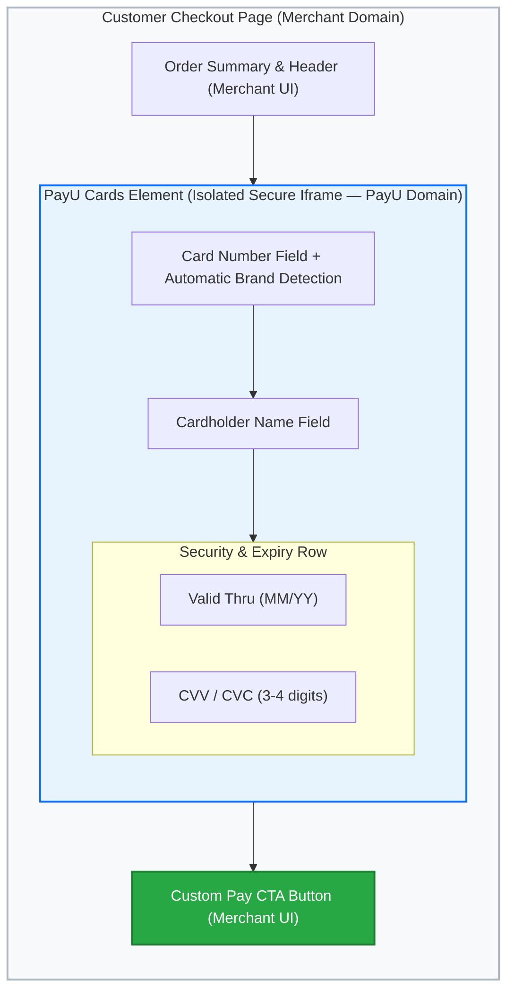
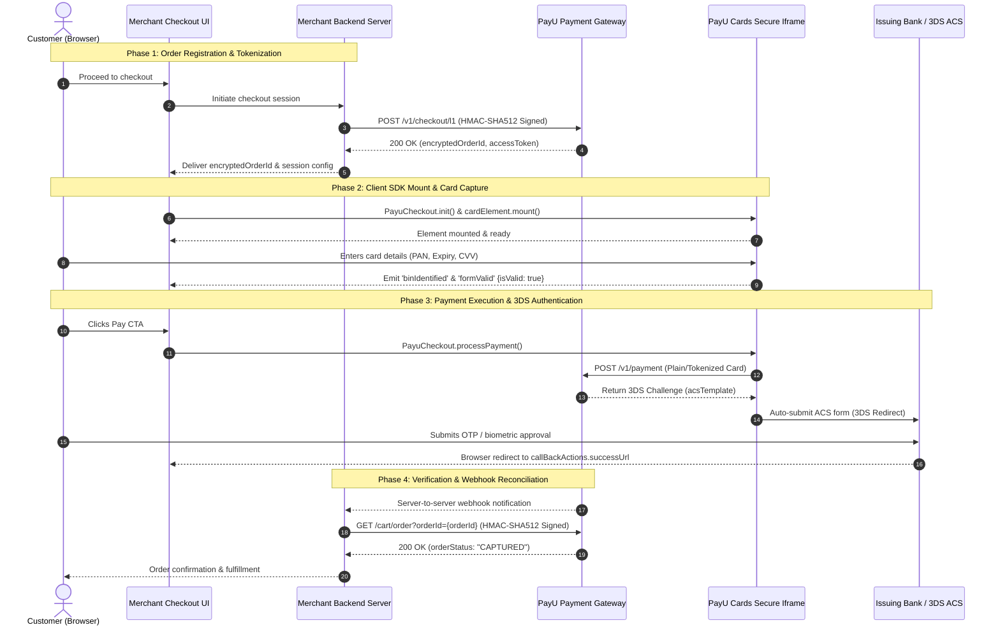

**PayU Cards Element** is a drop-in card payment solution that combines a lightweight client-side JavaScript SDK with secure backend APIs. It enables merchants to build a seamless, native card checkout experience directly inside their web application while drastically reducing compliance overhead.

Sensitive cardholder data—Card Number (PAN), Expiry Date, and CVV—is entered exclusively inside an isolated, PayU-hosted iframe rendered seamlessly into the merchant's checkout container. Because raw cardholder credentials never touch the merchant's frontend scripts or backend servers, merchants qualify for the simplest **PCI DSS SAQ A** compliance tier.

***

## Architecture & Layout Boundary

The diagram below illustrates how PayU Cards Element partitions UI control between the merchant checkout container and PayU's isolated iframe environment:

<Callout icon="📘" theme="info">
  ### **PCI DSS Scope Reduction (SAQ A)**

  Because sensitive cardholder fields (Card Number, Expiry, CVV) reside strictly inside the sandboxed PayU iframe, your web application and application servers are fully decoupled from raw card data handling. Merchants qualify for **PCI DSS Self-Assessment Questionnaire A (SAQ A)** instead of SAQ A-EP or SAQ D.
</Callout>

***

## Key Capabilities & Benefits

| Capability                              | Merchant Advantage                                                                                                                                      |
| :-------------------------------------- | :------------------------------------------------------------------------------------------------------------------------------------------------------ |
| **PCI DSS SAQ A Eligibility**           | Eliminates cardholder data security liability; sensitive PAN and CVV fields never touch merchant servers or JavaScript contexts.                        |
| **Complete Design System Control**      | Customize input typography, border weights, focus borders, placeholder styling, label placements, and container spacing to seamlessly match your brand. |
| **Responsive Grid & Flexbox Layouts**   | Position fields across single or multi-row configurations with custom flex ratios (e.g., placing Expiry and CVV side-by-side).                          |
| **Real-Time BIN & Scheme Detection**    | Automatically detects card scheme (Visa, Mastercard, RuPay, Amex, Diners, Maestro), issuing bank, and card tier as the user types.                      |
| **Interactive Live Card Preview**       | Optional virtual card preview chrome that visually updates the card logo, masked digits, cardholder name, and expiry date in real time.                 |
| **Integrated Offers & Discount Engine** | Validate instant bank discount/cashback promo codes and display revised cart totals directly inside the card flow.                                      |
| **Credit & Debit Card EMI Support**     | Query eligible card EMI options and tenures in real time to increase average order values.                                                              |
| **Tokenization & Stored Cards**         | Native support for RBI-compliant Card-on-File (CoF) tokenization and network tokens for repeat frictionless checkouts.                                  |

***

## Target Use Cases

* **Direct-to-Consumer (D2C) & Retail**: Eliminate full-page external redirects during card detail entry, keeping bounce rates low and maximizing checkout conversion.
* **Travel, Ticketing & Hospitality**: Highly customized checkout layouts that blend seamlessly into multi-step booking funnels.
* **Subscription & SaaS Platforms**: Collect card details securely during initial customer onboarding while setting up recurring Standing Instructions (SI).

***

## End-to-End Integration Flow

The following sequence diagram outlines the end-to-end integration flow across the customer browser, merchant backend, PayU payment gateway, and issuing bank 3DS ACS:

***

## Integration Phases Explained

### Phase 1: Order Registration (Server-to-Server)

Your backend initiates the checkout session by calling `POST /v1/checkout/l1`. The request is secured using an HMAC-SHA512 signature in the `Authorization` header. PayU returns session credentials, including `transaction.encryptedOrderId` and `transaction.accessToken`. Your backend forwards the `encryptedOrderId` to the customer's browser session.

### Phase 2: Client SDK Mount & Card Capture (Frontend)

The customer browser loads the PayU Checkout JS SDK and initializes it using `PayuCheckout.init({ orderId: encryptedOrderId })`. The merchant creates a `cardForm` instance with custom styling and mounts it to an empty `
` container in the DOM. As the customer enters card information:

- The SDK identifies the card scheme and bank via the `binIdentified` event.
- Input validation state is broadcast through the `formValid` event (`isValid: true | false`).
- Merchant custom pay buttons remain disabled until `formValid` returns `true`.

### Phase 3: Payment Execution & 3DS Authentication

When the customer clicks the merchant's Pay button, the frontend calls `PayuCheckout.processPayment()`. The SDK securely transmits card credentials directly to PayU (`POST /v1/payment`). For transactions requiring two-factor authentication, the SDK receives the 3DS ACS challenge template and auto-submits the form to redirect the customer to their bank's OTP page.

### Phase 4: Verification & Webhook Reconciliation

Upon completing 3DS verification, the customer's browser is redirected to the `callBackActions.successUrl` specified during order creation. Concurrently, PayU delivers a server-to-server webhook notification to your backend. Your application server validates the final payment status by calling `GET /cart/order?orderId={orderId}` before confirming the order and fulfilling items.

***

## The Cards Element Contracts Suite

Access the detailed API specifications and SDK reference guides below:

| Resource                   | Protocol / Type        | Purpose                                                                               | Reference Link                                                              |
| :------------------------- | :--------------------- | :------------------------------------------------------------------------------------ | :-------------------------------------------------------------------------- |
| **Create Order API**       | `POST /v1/checkout/l1` | Registers order, initializes session, generates `encryptedOrderId`.                   | [Create Order API Reference](api-cards-element-create-order.md)             |
| **Create Transaction API** | `POST /v1/payment`     | Server-to-server card payment execution for plain and tokenized cards.                | [Create Transaction API Reference](api-cards-element-create-transaction.md) |
| **Fetch Order Status API** | `GET /cart/order`      | Verifies order state and reconciles payment status.                                   | [Fetch Order Status API Reference](api-cards-element-fetch-order-status.md) |
| **Checkout JS SDK**        | Client JavaScript      | Renders secure iframe, handles card input styling, and initiates client-side payment. | [Checkout JS SDK Reference](js-card-element-sdk-reference.md)               |

***

## Security Best Practices

1. **Keep Merchant Secret Confidential**: All HMAC-SHA512 signatures must be generated exclusively on your backend server. Never expose your `secret` or `merchantKey` in client-side code, mobile apps, or public repositories.
2. **Always Use&#x20;**`encryptedOrderId`**&#x20;in Browser Context**: Pass only `transaction.encryptedOrderId` to `PayuCheckout.init()`. Never pass raw merchant order IDs or database primary keys to client-side scripts.
3. **Mandatory HTTPS**: All callback URLs (`successUrl`, `failureUrl`, `cancelUrl`) and webhook endpoints must be secured with valid TLS/SSL certificates (`<redacted URL>`).
4. **Never Rely Solely on Browser Redirects**: Network interruptions or closed browser tabs can prevent a customer from reaching `successUrl`. Always rely on server-to-server webhooks and the Fetch Order Status API (`GET /cart/order`) as your source of truth for order fulfillment.
