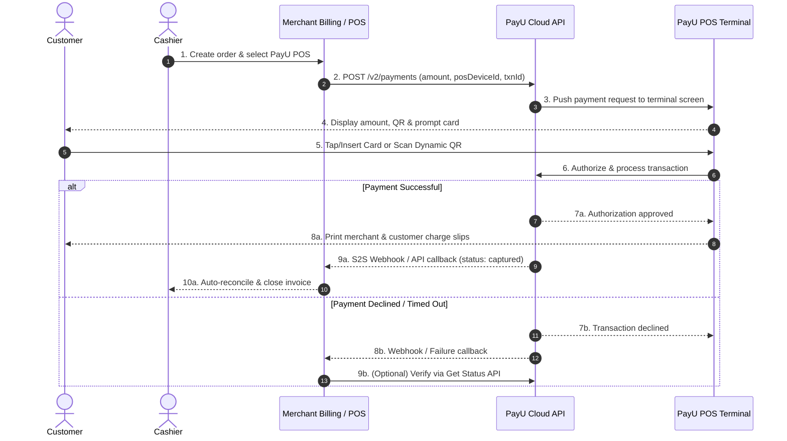

---
title: Offline Payments - Merchant Overview
excerpt: Accept in-store card, UPI, and wallet payments at physical store counters using PayU POS terminals and QR devices.
deprecated: false
hidden: false
metadata:
  robots: index
---

## What is PayU Offline Payments?

PayU Offline Payments is an in-store payment solution that enables merchants to accept card, UPI, wallet, and EMI payments directly at physical checkout counters. Designed for retail stores, supermarkets, restaurants, quick-service counters, and service outlets, PayU connects certified in-store payment hardware directly to your billing software, Point of Sale (POS), or ERP system through secure Cloud APIs.

<Callout icon="📘" theme="info">
  ### **Key Capabilities for Merchants**
  - **Omni-Channel Payment Acceptance**: Accept debit and credit cards (RuPay, Visa, Mastercard via EMV chip, contactless tap, and swipe), Dynamic Bharat QR (UPI DBQR), Wallets, and checkout EMI on a single terminal.
  - **Automated Bill Closure**: Push payable amounts directly from your billing software to the counter terminal. Invoices reconcile and close automatically upon payment confirmation with zero manual entry errors.
  - **Built-in Thermal Printing**: Terminals print merchant and customer receipt charge slips automatically upon transaction success.
  - **Flexible Counter Deployment**: Run integrated smart POS terminals alongside standalone Static QR standees and Soundboxes under a single Merchant ID (MID).
  - **Instant Audio & App Alerts**: Receive real-time voice confirmations on Soundbox devices and immediate push alerts on the PayU Merchant App.
</Callout>

---

## In-Store Devices & Supported Modes

PayU provides dedicated hardware suited to different counter setups, checkout volumes, and store operations:

<Cards columns="2">
  <Card title="POS Devices" href="#pos-devices">
    Smart countertop terminals accepting cards (RuPay, Visa, Mastercard), Dynamic UPI QR, Wallets, and EMI with integrated receipt printing.
  </Card>

  <Card title="Static QR Devices" href="#static-qr-devices">
    Standees and Soundboxes for cost-effective UPI acceptance with instant voice announcements or mobile app alerts.
  </Card>
</Cards>

### POS Devices
Terminals deployed at checkout counters to handle card, wallet, and UPI transactions. Choose these when your business accepts debit/credit cards and requires printed charge slips:

- **Android POS**: A high-performance smart terminal featuring a full touchscreen display, built-in thermal receipt printer, and multi-mode payment acceptance (EMV chip, NFC contactless tap, magnetic stripe, and Dynamic UPI QR).

<Image src="https://files.readme.io/40d710b85ec264236706fae868e57272a5cbfa92942e11ac0b2d16c66c46c076-android-pos.png" width="350px" />

- **All-in-One POS**: A compact countertop terminal with an integrated customer-facing Dynamic QR screen, chip and contactless card reader, and built-in voice confirmation for completed payments.

  <Image src="https://files.readme.io/f10a1c2d363c69aa6ffca53b34f8a3f3c3f09c8e0396cff8f4eb03b56b07db80-all-in-one-post.png" width="350px" />

### Static QR Devices
Lightweight, rapid-deployment solutions dedicated to UPI acceptance. Cheaper to deploy and quick to set up:

- **Smart QR Soundbox**: A physical Static QR standee equipped with an integrated cellular speaker that instantly announces successful payment amounts in the cashier's preferred language.

  <Image src="https://files.readme.io/10c55e34c7a6bef00b4322bf2927e637d305bcfe5099695b20f75a2dab6eae96-static-qr-device.png" width="350px" />

- **Static QR Standee**: A printed QR standee placed at the counter. The customer scans the QR code, enters the bill amount in their preferred UPI app, and payment alerts reach the cashier via the PayU Merchant App.

  <Image src="https://files.readme.io/c1e7e66410c8584748706e9a48f6d64534a8446da98dd63e23f67889ab2c09d7-static-qr-standee.png" width="350px" />

### Device Feature Matrix

| Device | Supported Payment Modes | Integrated Mode (Cloud API) | Standalone Mode (Manual Entry) | Built-In Receipt Printer | Best Suited For |
| :--- | :--- | :--- | :--- | :--- | :--- |
| **Android POS** | RuPay, Visa, Mastercard, UPI (Dynamic QR), Wallets, EMI | **Yes** | **Yes** | **Yes** (Thermal) | Supermarkets, retail stores, restaurants |
| **All-in-One POS** | RuPay, Visa, Mastercard, UPI (Dynamic QR), Wallets | **Yes** | **Yes** | No (Digital/Voice) | Pharmacies, quick-service counters, compact desks |
| **Smart QR Soundbox** | UPI | No | **Yes** | No (Audio alert) | High-volume retail counters, grocery stores |
| **Static QR Standee** | UPI | No | **Yes** | No (App alert) | Kiosks, pop-up stalls, low-cost counter deployments |

---

## How Integration Works

PayU Offline Payments supports two operational models across your store fleet:

### 1. Integrated Mode (POS / ERP Integration)
In this mode, your billing software or ERP initiates and reconciles the payment:

1. **Bill Generation**: The cashier creates the order in your billing/ERP system.
2. **Cloud API Trigger**: Your billing software calls the **Initiate Payment (Sale) API** with the transaction amount, unique merchant transaction ID (`txnId`), and the target counter's `posDeviceId`.
3. **Validation & Terminal Push**: PayU verifies that the device is active and mapped to your Merchant ID, then pushes the transaction over the cloud to the terminal screen.
4. **Customer Payment**: The customer chooses their preferred payment method on the terminal (taps/inserts card, scans dynamic UPI QR, or selects wallet/EMI) and authorizes the transaction.
5. **Receipt Printing**: Upon successful authorization, the terminal displays the confirmation and automatically prints the charge slip on its built-in thermal printer.
6. **Automatic Bill Closure**: PayU sends a server-to-server webhook notification to your billing server, closing the bill and updating inventory in real-time.

<Callout icon="⚠️" theme="warn">
  ### **Mandatory: Implement Status Enquiry API**
  Counter connectivity disruptions or customer timeouts may occasionally prevent immediate response delivery even if funds have moved. To avoid duplicate charges or stranded orders, your billing system **must call the Get Status API** before voiding or retrying an unconfirmed transaction.
</Callout>

### 2. Standalone Mode (Non-Integrated)

- The cashier enters the amount directly on the POS device keypad, or the customer scans the Static QR standee and enters the amount on their phone.
- No software integration or API call is required.
- Transactions reconcile post-payment via the **PayU Merchant Dashboard**, daily settlement reports, or the PayU Merchant App.

<Callout icon="💡" theme="info">
  ### **Hybrid Setups**:&#x20;

  You can mix integrated Android POS terminals at primary billing lanes with standalone Static QR standees or Soundboxes at express counters under the same Merchant ID.
</Callout>

---

## Prerequisites

Before initiating in-store transactions via API, verify the following prerequisites:

<Callout icon="🚨" theme="error">
  ### **Device Activation & Account Mapping**
  Every physical POS terminal **MUST be active and mapped to your PayU Merchant ID (MID)** by your PayU onboarding team before it can receive cloud payment requests.

  If you call the API with an inactive, unmapped, or incorrect `posDeviceId`, PayU rejects the request with status code **`E342`** *(Transaction not initiated)* or **`E2081`** *(Invalid Device ID)*.
</Callout>

### Setup Checklist
1. **Active PayU Merchant Account**: Obtain your live/test **Merchant Key**, **Salt**, and **Account ID** from the [PayU Merchant Dashboard](https://onboarding.payu.in/app/account/signin).
2. **Terminal Serial Number & Device ID**: Ensure your assigned POS device is registered and mapped. Note the `posDeviceId` assigned to each counter.
3. **Terminal Connectivity**: Ensure POS terminals have an active Wi-Fi connection or an activated 4G data SIM.
4. **HTTPS Webhook Listener**: Configure a publicly accessible HTTPS endpoint on your server to receive real-time transaction updates. Ensure your firewall allows inbound webhook postbacks from PayU.
5. **Server-Side Security**: Never store your API Salt or compute hashes within client-side billing scripts or on POS terminals. Always generate authorization signatures on your secure server.

---

## Benefits of PayU Offline Payments

### For Your Business
- **Eliminate Cashier Errors**: Pushing bill amounts directly from the ERP prevents manual key-in errors, mismatched totals, and reconciliation gaps.
- **Faster Checkout Throughput**: Reduce queue times with instant NFC contactless card taps and Dynamic QR generation on the terminal.
- **Unified Reporting**: View online and in-store transactions, refunds, chargebacks, and daily settlements in a single pane on the PayU Merchant Dashboard.
- **Automated Real-Time Reconciliation**: S2S webhooks and Status Enquiry APIs ensure your ERP ledger matches payment outcomes automatically.

### For Your Customers
- **Broad Payment Choice**: Customers can pay via debit/credit cards (RuPay, Visa, Mastercard), UPI apps (Google Pay, PhonePe, Paytm, BHIM), Wallets, or convert large tickets into instant EMIs.
- **Frictionless & Contactless**: Quick tap-and-pay for cards under ₹5,000 without PIN entry, and instant QR scanning for UPI users.
- **Immediate Physical Confirmation**: On-the-spot printed charge slips and clear terminal screen confirmation.

---

<Callout icon="far fa-book" theme="warn">
  ## Partner Integration Offering

  Omni POS Integration can be integrated on Partner platform. For more information, refer [Collect Payment with PayU Omni.](doc:collect-payment-with-payu-omni)
</Callout>

## Next Steps

1. Integration POS using **v2/payments** API. For more information, refer to [Omni POS Integration.](doc:omni-pos-integration)
2. Verify the Transaction Status ( \\<awaiting info> ).&#x20;
