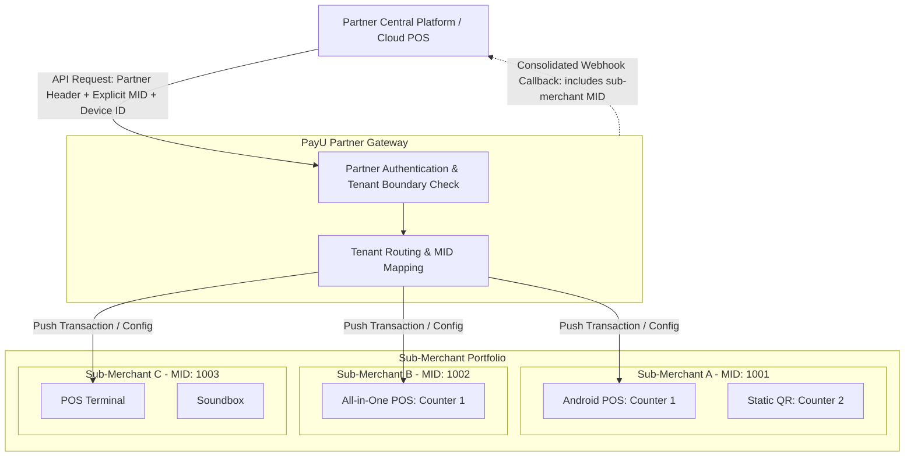

## What is PayU Offline Payments for Partners?

The PayU Offline Payments Partner solution is purpose-built for POS software providers, ERP platforms, billing aggregators, and financial intermediaries. With a single unified integration, partners can onboard retail merchants, provision in-store payment hardware, generate static UPI QR codes, initiate in-store transactions, and manage portfolio-wide settlements.

<Callout icon="📘" theme="info">
  ### **Core Partner Capabilities**

  - **Multi-Tenant Fleet Management**: Run and monitor in-store payments across thousands of sub-merchants through one unified partner gateway.
  - **End-to-End Lifecycle APIs**: Programmatically onboard new merchants, issue static QR codes from dedicated VPA pools, and monitor terminal health.
  - **Modular Architecture**: Integrate only what you need. Partners who only onboard and provision merchants can skip transaction APIs entirely.
  - **Centralized Callbacks with Fan-Out**: Receive real-time payment updates on a single partner webhook endpoint, with explicit Merchant IDs (MIDs) for automated routing.
</Callout>

***

## Supported In-Store Hardware for Your Merchants

PayU supplies certified hardware solutions that partners can allocate to their sub-merchants based on store format and volume:

<Cards columns="2">
  <Card title="POS Devices" href="#pos-devices">
    Smart countertop terminals accepting chip, contactless cards, and Dynamic UPI QR. Supports integrated cloud routing.
  </Card>

  <Card title="Static QR Solutions" href="#static-qr-solutions">
    Low-cost Standees and Soundboxes for high-speed UPI acceptance with instant voice announcements.
  </Card>
</Cards>

### POS Devices

- **Android POS**: Full-featured smart terminal with a touchscreen display, built-in thermal printer, and support for Visa, Mastercard, RuPay, and Dynamic UPI QR. Can be integrated directly with your POS software via partner APIs.
- **All-in-One POS**: Countertop unit featuring an integrated customer-facing Dynamic QR display, tap & chip card reader, and built-in voice confirmation.

### Static QR Solutions

- **Smart QR Soundbox**: Standee equipped with a cellular speaker providing instant audio payment confirmations in regional languages. Ideal for high-turnaround retail counters.
- **Static QR Standees**: Low-cost printed standees generated programmatically from your allocated VPA series for instant merchant go-live.

### Device & Partner Capability Matrix

| Device                | Payment Modes Supported                   | Partner Integrated (Cloud API) | Non-Integrated (Standalone) | Partner Scope                                                |
| :-------------------- | :---------------------------------------- | :----------------------------- | :-------------------------- | :----------------------------------------------------------- |
| **Android POS**       | RuPay, Visa, Mastercard, UPI (Dynamic QR) | **Yes**                        | **Yes**                     | Device provisioning, terminal mapping, transaction routing   |
| **All-in-One POS**    | RuPay, Visa, Mastercard, UPI (Dynamic QR) | **Yes**                        | **Yes**                     | Device provisioning, terminal mapping, transaction routing   |
| **Smart QR Soundbox** | UPI                                       | No                             | **Yes**                     | Merchant assignment, inventory management, audio alerts      |
| **Static QR Standee** | UPI                                       | No                             | **Yes**                     | Programmatic API generation from reserved partner VPA series |

***

## Multi-Tenant Architecture (Many MIDs)

Unlike single-merchant integrations, partner integrations operate across a portfolio of independent businesses:

- **Partner-Level Authorization**: The partner authenticates using central partner credentials. One integration serves your entire merchant portfolio.
- **Explicit MID Targeting**: Every transaction, status inquiry, or provisioning request must explicitly supply the sub-merchant's `MID` alongside the terminal `posDeviceId`.
- **Tenant Validation & Security**: PayU enforces strict tenant boundary checks. If a request references an `MID` that is not mapped to your partner account, the API automatically rejects the call.
- **Centralized Callbacks & Fan-Out**: PayU delivers all event notifications (payment captured, failed, or canceled) to a single configured partner webhook endpoint. The payload contains the sub-merchant `MID`, allowing your backend to route the result to the respective store ledger.

***

## What a Partner Integrates

Depending on your business model, you can choose to implement all or specific modules:

### 1. Merchant Onboarding & Provisioning

Enable your sub-merchants to accept offline payments through PayU:

- **API Onboarding**: Submit sub-merchant business details, KYC documents, and bank account information via the Onboarding API. Poll for status updates until the account is approved and active.
- **Referral Flow**: Refer merchants directly to PayU's self-serve onboarding portal. Requires zero API integration on your side.

### 2. Static QR Generation & Allocation

- Programmatically generate Static QR codes and VPAs from a restricted VPA series reserved exclusively for your partner account.
- Map generated VPAs to sub-merchants and counters automatically.
- Receive centralized UPI payment callbacks with sub-merchant MIDs for instant ledger updates.

### 3. In-Store Transaction Processing (Optional for Transaction Aggregators)

If your POS software pushes payments to in-store devices on behalf of merchants:

- **Partner Transaction API**: Trigger payment requests on sub-merchant POS devices with explicit `MID` and `posDeviceId`.
- **Status Enquiry API (Mandatory for Integrators)**: Resolve timed-out, pending, or interrupted terminal sessions programmatically.
- **Void & Refund API**: Void un settled transactions or initiate refunds against sub-merchant transactions.

_(Note: Partners who strictly provide onboarding and device provisioning without routing transactions can skip this module.)_

### 4. Portfolio Operations

- **Consolidated Settlement**: Access portfolio-wide settlement breakdowns and individual sub-merchant payout reports.
- **Portfolio Refunds**: Initiate and track refunds across your sub-merchant network.
- **Multi-Merchant Reporting**: Ingest aggregated and store-level transaction histories.

***

## Partner Devguide Roadmap

Explore the partner documentation suite to begin your implementation:

### Core References & Setup

| Guide                      | Description                                                                   | Reference Link                                      |
| :------------------------- | :---------------------------------------------------------------------------- | :-------------------------------------------------- |
| **Partner Authentication** | Partner-level credentials, token generation, and header formats.              | [Partner Authentication](/reference/authentication) |
| **Environments & Sandbox** | Base URLs, partner test credentials, and simulator devices.                   | [Partner Environments](/reference/environments)     |
| **Error Codes**            | Error codes for partner authorization, mapping failures, and terminal states. | [Partner Error Codes](/reference/error-codes)       |

### Merchant Lifecycle & QR APIs

| Guide                    | Description                                                             | Reference Link                                 |
| :----------------------- | :---------------------------------------------------------------------- | :--------------------------------------------- |
| **Merchant Onboarding**  | Submit merchant applications, poll status, and handle lifecycle states. | [Merchant Onboarding API](/partner/onboarding) |
| **Static QR Generation** | Allocate static QR VPAs from your dedicated series to sub-merchants.    | [Static QR Generation](/partner/static-qr)     |
| **Static QR Callbacks**  | Configure single partner callback endpoint and implement fan-out.       | [Partner Callbacks](/partner/callbacks)        |

### Partner Transaction APIs _(For Transaction Integrators)_

| Guide                       | Description                                                     | Reference Link                                    |
| :-------------------------- | :-------------------------------------------------------------- | :------------------------------------------------ |
| **Partner Transaction API** | Initiate in-store payments with explicit `MID` and `Device ID`. | [Partner Transaction API](/partner/sale)          |
| **Partner Get Status API**  | Resolve unknown or timed-out transactions across sub-merchants. | [Partner Status Enquiry](/partner/status-enquiry) |
| **Partner Void and Refund** | Cancel authorizations or refund sub-merchant POS payments.      | [Partner Void & Refund](/partner/void-refund)     |

### Portfolio Operations & Settlement

| Guide                    | Description                                                     | Reference Link                              |
| :----------------------- | :-------------------------------------------------------------- | :------------------------------------------ |
| **Portfolio Settlement** | Track multi-merchant settlement batches and payout breakdowns.  | [Portfolio Settlement](/partner/settlement) |
| **Portfolio Refunds**    | Execute post-settlement refunds across your sub-merchant fleet. | [Portfolio Refund API](/partner/refund)     |

***

## Next Steps

<Cards columns="3">
  <Card title="1. Partner Auth" href="/reference/authentication">
    Configure partner authorization credentials and sandbox access.
  </Card>

  <Card title="2. Onboard Merchants" href="/partner/onboarding">
    Automate sub-merchant onboarding and KYC submissions via API.
  </Card>

  <Card title="3. Deploy In-Store Solutions" href="/partner/sale">
    Issue static QR standees or push transactions to mapped POS terminals.
  </Card>
</Cards>