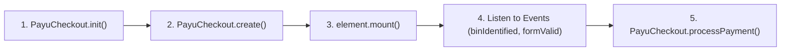

---
title: Checkout JS SDK (Card Element) Reference
excerpt: Client-side JavaScript reference for embedding, styling, and orchestrating PayU Cards Element.
---

The **PayU Checkout JS SDK** provides client-side methods to embed secure card inputs directly on your checkout page. All sensitive cardholder data (Card Number, Expiry, CVV) is captured inside an isolated, sandboxed PayU iframe, ensuring your web application remains strictly in PCI DSS SAQ A scope.

---

## Script Inclusion

Include the PayU Checkout SDK on your checkout page using the appropriate CDN bundle:

### Production CDN
```html
<script src="<redacted URL>"></script>
```

### Sandbox / UAT CDN
```html
<script src="<redacted URL>"></script>
```

---

## Global Object & Lifecycle

Upon loading, the SDK exposes `window.PayuCheckout` as a singleton interface:



---

## Methods Reference

### `PayuCheckout.init(config)`
Initializes the SDK session. Must be called before creating any elements.

#### Mandatory Parameters

| Parameter | Description |
| :--- | :--- |
| orderId | _String_<br>The encrypted order identifier returned as `result.transaction.encryptedOrderId` from the Create Order API (`POST /v1/checkout/l1`). |
| env | _String_<br>Target environment. Pass `test` or `prod`. |

```javascript
PayuCheckout.init({
  orderId: "e4f8a3c2b1d0...[encryptedOrderId]...",
  env: "test"
});
```

---

### `PayuCheckout.create(elementType, options)`
Creates a secure card input element instance.

#### Mandatory Parameters

| Parameter | Description |
| :--- | :--- |
| elementType | _String_<br>The type of element to instantiate. For card checkout, pass `"cardForm"`. |

#### Optional Parameters

| Parameter | Description |
| :--- | :--- |
| options | _Object_<br>Configuration object defining styling, layout rows, placeholders, and card preview display. |

```javascript
const cardElement = PayuCheckout.create("cardForm", {
  layout: {
    rows: [
      { fields: ["cardNumber"] },
      { fields: ["ownerName"] },
      { fields: ["validThrough", "cvv"], ratios: [0.6, 0.4] }
    ]
  },
  cardPreview: {
    display: true
  }
});
```

---

### `cardElement.mount(domSelector)`
Mounts the card element iframe into a designated DOM container on your checkout page.

#### Mandatory Parameters

| Parameter | Description |
| :--- | :--- |
| domSelector | _String_<br>CSS selector of the host container (e.g. `"#payu-card-container"`). |

```javascript
cardElement.mount("#payu-card-container");
```

---

### `cardElement.unmount()`
Unmounts the iframe from the DOM while preserving configuration.

---

### `cardElement.clear()`
Clears all user inputs entered in the card element fields.

---

### `cardElement.focus(fieldName)`
Transfers focus to a specific input field within the secure iframe (`cardNumber`, `validThrough`, `cvv`, or `ownerName`).

---

### `PayuCheckout.processPayment(options)`
Submits card credentials directly to PayU and initiates payment authorization and 3DS challenge redirection.

```javascript
try {
  const result = await PayuCheckout.processPayment();
  console.log("Payment initiated:", result);
} catch (error) {
  console.error("Payment error:", error);
}
```

---

## Events Reference

Register listeners to handle validation updates and card detection:

```javascript
cardElement.on("formValid", (event) => {
  // Toggle merchant Pay CTA button based on card validity
  document.getElementById("btn-pay").disabled = !event.isValid;
});

cardElement.on("binIdentified", (event) => {
  console.log("Card Network:", event.cardType); // VISA, MASTERCARD, RUPAY
  console.log("Issuing Bank:", event.issuingBank); // HDFC, ICICI, SBI
});
```

| Event | Description | Payload Data |
| :--- | :--- | :--- |
| `ready` | Fired when the secure iframe finishes loading and is interactive. | `{ isReady: true }` |
| `formValid` | Fired when overall form validity changes. | `{ isValid: boolean }` |
| `binIdentified` | Fired when 6-8 digits are entered and the card BIN is resolved. | `{ cardType: string, issuingBank: string, category: string }` |
| `change` | Fired whenever an input field value changes. | `{ field: string, isEmpty: boolean, isValid: boolean }` |
| `error` | Fired when an initialization or rendering error occurs. | `{ code: string, message: string }` |
