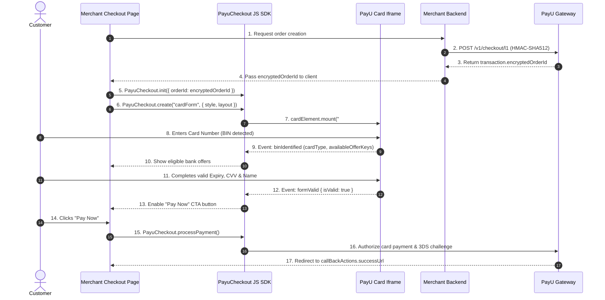

The **PayU Checkout JS SDK** enables you to embed a secure, PCI-compliant card payment form directly on your checkout page using an isolated iframe. The SDK manages secure card input, Luhn validation, real-time BIN detection, bank offer validation, and payment processing without sensitive cardholder data ever touching your server or parent DOM.

<Cards_PayU_Labs />

<br />

## Quick Integration Architecture



***

## SDK Installation & CDN Endpoints

Include the official PayU Checkout Elements JS script tag on your payment page before initializing the SDK:

<Tabs>
  <Tab title="Production">
    ```html
    <script src="https://jssdk.payu.in/checkout/payu-checkout-elements.umd.js"></script>
    ```
  </Tab>

  <Tab title="Sandbox / UAT">
    ```html
    <script src="https://jssdk-uat.payu.in/checkout/payu-checkout-elements.umd.js"></script>
    ```
  </Tab>
</Tabs>

***

## 1. Top-Level `PayuCheckout` Object

The SDK exports a global `PayuCheckout` singleton on `window`.

### Properties

| Property                   | Type      | Description                                                                                          |
| :------------------------- | :-------- | :--------------------------------------------------------------------------------------------------- |
| `PayuCheckout.initialized` | `boolean` | Returns `true` once `PayuCheckout.init()` has been successfully executed with a valid order context. |

***

### Methods

#### `PayuCheckout.init(config)`

Initializes the SDK session. **Must be invoked before creating any elements.**

```javascript
PayuCheckout.init({
  orderId: "c422540c33ef9f1259f15f7b916469b7227dc1d41a76796536885474ddadf312"
});
```

* **Configuration Parameters:**
  | Parameter | Type     | Required | Description                                                                                                                                                      |
  | :-------- | :------- | :------- | :--------------------------------------------------------------------------------------------------------------------------------------------------------------- |
  | `orderId` | `string` | **Yes**  | The `transaction.encryptedOrderId` returned by the server-side [Create Order API](doc:api-cards-element-create-order). Do not pass the plain merchant `orderId`. |

***

#### `PayuCheckout.create(elementType, options)`

Creates and returns a new `PaymentElement` instance.

```javascript
const cardElement = PayuCheckout.create("cardForm", {
  offerKeys: ["HDFC_10_PERCENT"],
  style: {
    width: "100%",
    minHeight: "280px"
  }
});
```

* **Supported&#x20;**`elementType`**&#x20;values:**
  | Element Type    | Description                                                                                           |
  | :-------------- | :---------------------------------------------------------------------------------------------------- |
  | `'cardForm'`    | Standard credit/debit card form with Card Number, Name, Expiry, CVV, and optional Card Preview panel. |
  | `'emiCardForm'` | Specialized card form including EMI tenure selection. Requires `bankCode` option.                     |
  | `'UATP'`        | Universal Air Travel Plan card form tailored for airline checkout journeys.                           |

* `options`**&#x20;Structure:**
  | Option           | Type       | Required    | Description                                                  |
  | :--------------- | :--------- | :---------- | :----------------------------------------------------------- |
  | `offerKeys`      | `string[]` | No          | Array of offer keys to pre-apply during initialization.      |
  | `bankCode`       | `string`   | Conditional | Required for `emiCardForm` (e.g. `'HDFCCC03'`).              |
  | `issuerBankCode` | `string`   | No          | Specific issuer bank code for EMI transactions.              |
  | `emiTenure`      | `number`   | No          | Pre-selected tenure in months for EMI transactions.          |
  | `emiCardType`    | `string`   | No          | Card type indicator for EMI (e.g. `'cc'`).                   |
  | `style`          | `object`   | No          | Container, input fields, and preview styling configurations. |
  | `layout`         | `array`    | No          | Custom row and field layout configuration.                   |

***

#### `PayuCheckout.applyOffer(offerKeys)`

Applies one or more promo/discount offer keys to the active payment session. This method returns `void`. Always subscribe to the `offerValidated` event to receive the validation result.

```javascript
PayuCheckout.applyOffer(["HDFC_SUMMER_CASHBACK", "TRAVEL_OFFER_2026"]);
```

* **Parameters:**
  | Parameter   | Type       | Required | Description                                                                       |
  | :---------- | :--------- | :------- | :-------------------------------------------------------------------------------- |
  | `offerKeys` | `string[]` | **Yes**  | Array of offer keys to validate and apply against the current card BIN and order. |

***

#### `PayuCheckout.removeOffer()`

Clears all currently applied offers from the payment session. Takes no arguments and returns `void`.

```javascript
PayuCheckout.removeOffer();
```

***

#### `PayuCheckout.processPayment(options?)`

Executes payment authorization against the active mounted element. Returns a `Promise`.

```javascript
try {
  const result = await PayuCheckout.processPayment({
    additionalInformation: {
      billingInformation: {
        addressLine1: "123 Main Street",
        addressLine2: "Apt 4B",
        city: "Mumbai",
        state: "Maharashtra",
        country: "India",
        postalCode: "400001"
      }
    }
  });
  console.log("Payment completed successfully:", result);
} catch (error) {
  console.error("Payment failed:", error);
}
```

* **Parameters:**
  | Parameter                                          | Type     | Required    | Description                                                                                                                                  |
  | :------------------------------------------------- | :------- | :---------- | :------------------------------------------------------------------------------------------------------------------------------------------- |
  | `options`                                          | `object` | No          | Payment options container.                                                                                                                   |
  | `options.additionalInformation`                    | `object` | No          | Contextual metadata object.                                                                                                                  |
  | `options.additionalInformation.billingInformation` | `object` | Conditional | Mandatory for cross-border / international card payments. Contains `addressLine1`, `addressLine2`, `city`, `state`, `country`, `postalCode`. |

***

#### `PayuCheckout.on(event, handler)` & `PayuCheckout.off(event, handler)`

Subscribes to or unsubscribes from global SDK events.

```javascript
PayuCheckout.on("offerValidated", (data) => {
  console.log("Offer validated:", data.isValid, data.offerKeys);
});
```

***

#### `PayuCheckout.destroy()`

Cleans up the active SDK instance, removes all iframe DOM nodes, unbinds window `postMessage` listeners, and resets initialization state. Ideal for Single Page Applications (React, Angular, Vue) when navigating away from checkout routes.

```javascript
// React useEffect cleanup pattern
useEffect(() => {
  PayuCheckout.init({ orderId: encryptedOrderId });
  const cardElement = PayuCheckout.create("cardForm");
  cardElement.mount("#payu-card-container");

  return () => {
    PayuCheckout.destroy();
  };
}, [encryptedOrderId]);
```

***

## 2. `PaymentElement` Instance

Returned by `PayuCheckout.create(elementType, options)`.

### Properties

| Property          | Type      | Description                                                              |
| :---------------- | :-------- | :----------------------------------------------------------------------- |
| `element.mounted` | `boolean` | `true` if the iframe element is actively attached to the DOM.            |
| `element.ready`   | `boolean` | `true` when the iframe has fully loaded and is ready for customer input. |

***

### Methods

| Method                 | Parameters              | Returns | Description                                                                                                                                                                |
| :--------------------- | :---------------------- | :------ | :------------------------------------------------------------------------------------------------------------------------------------------------------------------------- |
| `mount(selector)`      | `string \| HTMLElement` | `void`  | Mounts the iframe into the target container. **Mount is a singleton operation** — auto-focuses the first field upon ready. Cannot mount again until `unmount()` is called. |
| `unmount()`            | None                    | `void`  | Detaches the iframe from the DOM and resets the singleton state.                                                                                                           |
| `clear()`              | None                    | `void`  | Clears all text input fields inside the element.                                                                                                                           |
| `focus()`              | None                    | `void`  | Explicitly moves focus to the first input field (`cardNumber`).                                                                                                            |
| `blur()`               | None                    | `void`  | Removes focus from all inputs inside the element.                                                                                                                          |
| `updateStyle(style)`   | `object`                | `void`  | Dynamically updates and merges partial styling properties into the iframe at runtime.                                                                                      |
| `updateLayout(layout)` | `array`                 | `void`  | Dynamically replaces the field and row layout structure at runtime.                                                                                                        |
| `on(event, handler)`   | `string, function`      | `void`  | Subscribes to element-level events.                                                                                                                                        |
| `off(event, handler)`  | `string, function`      | `void`  | Unsubscribes from element-level events.                                                                                                                                    |

***

## 3. Layout & Field Configuration

### Default Field IDs

| Field ID     | Field Name                 | Input Type | Auto-complete | Mandatory in Form |
| :----------- | :------------------------- | :--------- | :------------ | :---------------- |
| `cardNumber` | Card Number                | `numeric`  | `cc-number`   | **Yes**           |
| `nameOnCard` | Name on Card               | `text`     | `cc-name`     | Optional          |
| `expiry`     | Expiry Date (`MM / YY`)    | `numeric`  | `cc-exp`      | **Yes**           |
| `cvv`        | Card Verification Value    | `password` | `cc-csc`      | **Yes**           |
| `storeCard`  | Save Card Consent Checkbox | `checkbox` | —             | Optional          |

### Layout Definition (`options.layout`)

The `layout` parameter is an array of row objects defining how fields and slots are arranged:

```javascript
layout: [
  {
    id: "cardNumberRow",
    fields: ["cardNumber"],
    className: "w-full",
    gap: 16
  },
  {
    id: "detailsRow",
    fields: ["nameOnCard", "expiry", "cvv"],
    className: "flex-nowrap",
    gap: 16,
    fieldWidths: {
      nameOnCard: "flex-[2.25]", // ~53% width
      expiry: "flex-[1]",       // ~23.5% width
      cvv: "flex-[1]"           // ~23.5% width
    }
  },
  {
    id: "cardPreviewSlot",
    fields: ["cardPreview"]     // Renders card preview slot
  }
]
```

* **Row Object Properties:**
  | Property      | Type       | Description                                                                                      |
  | :------------ | :--------- | :----------------------------------------------------------------------------------------------- |
  | `id`          | `string`   | Unique identifier for the row container.                                                         |
  | `fields`      | `string[]` | Ordered array of field IDs or slot IDs (e.g. `cardPreview`) in this row.                         |
  | `className`   | `string`   | Optional CSS utility class string applied to the row wrapper.                                    |
  | `gap`         | `number`   | Spacing between fields in pixels.                                                                |
  | `fieldWidths` | `object`   | Key-value mapping of field ID to flex or width CSS class (e.g. `{"nameOnCard": "flex-[2.25]"}`). |

***

## 4. Styling Options (`options.style`)

### Container Styles

| Property             | Type     | Default   | Description                                               |
| :------------------- | :------- | :-------- | :-------------------------------------------------------- |
| `width`              | `string` | `'100%'`  | Outer iframe container width (e.g. `'100%'`, `'480px'`).  |
| `minHeight`          | `string` | `'280px'` | Minimum height reserved for the iframe container.         |
| `maxWidth`           | `string` | `'750px'` | Maximum container width constraint.                       |
| `borderRadius`       | `string` | `'8px'`   | Border radius applied to the outer container.             |
| `containerClassName` | `string` | `''`      | Optional CSS class name attached to outer form container. |

***

### Input Field Styles (`style.inputStyle`)

| Property           | Type     | Default     | Description                                             |
| :----------------- | :------- | :---------- | :------------------------------------------------------ |
| `borderWidth`      | `number` | `1`         | Border thickness in pixels.                             |
| `borderColor`      | `string` | `'#E5E7EB'` | Default input border color.                             |
| `borderColorFocus` | `string` | `'#3B82F6'` | Border color when input is active/focused.              |
| `borderColorError` | `string` | `'#EF4444'` | Border color when field fails validation.               |
| `borderRadius`     | `number` | `8`         | Corner radius of input fields in pixels.                |
| `backgroundColor`  | `string` | `'#FFFFFF'` | Input field background color.                           |
| `textColor`        | `string` | `'#1F2937'` | Primary input text color.                               |
| `placeholderColor` | `string` | `'#9CA3AF'` | Placeholder text color.                                 |
| `labelColor`       | `string` | `'#6B7280'` | Floating label text color.                              |
| `labelFontSize`    | `number` | `14`        | Font size of label in pixels.                           |
| `fontSize`         | `number` | `16`        | Font size of input text in pixels.                      |
| `fontWeight`       | `number` | `400`       | Input text font weight (`400` normal, `600` semi-bold). |
| `height`           | `number` | `60`        | Input field height in pixels.                           |
| `errorColor`       | `string` | `'#EF4444'` | Validation error message text color.                    |
| `errorFontSize`    | `number` | `12`        | Validation error message font size in pixels.           |

***

### Card Preview Styles (`style.cardPreview`)

The interactive card preview displays the real-time card brand logo, masked PAN, cardholder name, and expiry date.

| Property                      | Type              | Default      | Description                                                |
| :---------------------------- | :---------------- | :----------- | :--------------------------------------------------------- |
| `enabled`                     | `boolean`         | `true`       | Toggle card preview visibility.                            |
| `position`                    | `string`          | `'right'`    | Position relative to form (`'right'`, `'top'`).            |
| `width`                       | `string / number` | `'200px'`    | Preview card width.                                        |
| `height`                      | `string / number` | `'128px'`    | Preview card height.                                       |
| `showOnMobile`                | `boolean`         | `false`      | When `false`, preview is hidden on smaller mobile screens. |
| `style.background`            | `string`          | CSS Gradient | Card background color or linear gradient.                  |
| `style.borderRadius`          | `number`          | `16`         | Corner radius of preview card in pixels.                   |
| `style.cardNumberColor`       | `string`          | `'#FFFFFF'`  | Card number text color.                                    |
| `style.cardHolderColor`       | `string`          | `'#FFFFFF'`  | Cardholder name text color.                                |
| `style.expiryColor`           | `string`          | `'#FFFFFF'`  | Expiration date text color.                                |
| `style.labelColor`            | `string`          | `'#9CA3AF'`  | Header and footer labels text color.                       |
| `style.showBackgroundPattern` | `boolean`         | `true`       | Enables decorative background pattern on preview card.     |

***

## 5. Event Reference

### Element Events (`cardElement.on`)

| Event Name      | Payload Structure                                                                                                          | Description                                                                                                                     |
| :-------------- | :------------------------------------------------------------------------------------------------------------------------- | :------------------------------------------------------------------------------------------------------------------------------ |
| `ready`         | `{}`                                                                                                                       | Fires when the iframe has fully loaded, rendered input fields, and auto-focused.                                                |
| `formValid`     | `{ isValid: boolean }`                                                                                                     | **Critical Event**. Fires whenever form validity changes. Use to enable or disable your "Pay Now" button.                       |
| `change`        | `{ field: string, value: string, complete: boolean }`                                                                      | Fires on input change inside any field. Note: `value` is masked for card number and CVV.                                        |
| `focus`         | `{ field: string }`                                                                                                        | Fires when an input field gains focus.                                                                                          |
| `blur`          | `{ field: string }`                                                                                                        | Fires when an input field loses focus.                                                                                          |
| `escape`        | `{}`                                                                                                                       | Fires when the customer presses the Escape key inside any field.                                                                |
| `binIdentified` | `{ bin: string, cardType: string, issuer: string, isCardDomestic: boolean, valid: boolean, availableOfferKeys: string[] }` | Fires when the customer enters 6–8 digits of a card number. Use to display the card network logo and show eligible bank offers. |

***

### SDK Events (`PayuCheckout.on`)

| Event Name       | Payload Structure                                                         | Description                                                                                                                                   |
| :--------------- | :------------------------------------------------------------------------ | :-------------------------------------------------------------------------------------------------------------------------------------------- |
| `offerValidated` | `{ offerKeys: string[], isValid: boolean, availableOfferKeys: string[] }` | Fires after `applyOffer()` is called or when card input changes, reporting whether the selected offers are valid for the identified card BIN. |
| `showLoader`     | `{ visible: boolean }`                                                    | Fires when internal iframe network requests start or stop. Use to toggle full-page checkout loaders.                                          |
| `error`          | `{ code: string, message: string, details?: any }`                        | Fires when an operational or network failure occurs.                                                                                          |

***

## 6. Error Codes Reference

When an `error` event is emitted or a payment promise rejects, inspect the `code` attribute:

| Error Code         | Meaning                                                                    | Recommended Resolution                                                                                                  |
| :----------------- | :------------------------------------------------------------------------- | :---------------------------------------------------------------------------------------------------------------------- |
| `INIT_ERROR`       | SDK not initialized or invalid order parameters passed.                    | Verify that `PayuCheckout.init()` was called with a valid `transaction.encryptedOrderId`.                               |
| `MOUNT_ERROR`      | Target DOM container could not be found.                                   | Verify that the DOM selector element (e.g. `#payu-card-element-container`) exists in the DOM before calling `.mount()`. |
| `ALREADY_MOUNTED`  | `mount()` called while element is already mounted.                         | Call `element.unmount()` before attempting to remount into a different container.                                       |
| `VALIDATION_ERROR` | Customer submitted payment while form fields were incomplete or invalid.   | Listen to `formValid` and keep the "Pay Now" button disabled until `isValid === true`.                                  |
| `OFFER_ERROR`      | An applied offer key is invalid or incompatible with the entered card BIN. | Display an error banner in your offers UI and prompt the customer to remove or change the promo code.                   |
| `PAYMENT_ERROR`    | Gateway or bank rejected payment processing.                               | Display the error message and allow the customer to retry or choose an alternative payment method.                      |
| `TIMEOUT_ERROR`    | Transaction or session expired.                                            | Prompt the customer to refresh and restart the checkout process.                                                        |
| `NETWORK_ERROR`    | Client network connectivity lost during payment execution.                 | Prompt customer to check their internet connection and retry.                                                           |
